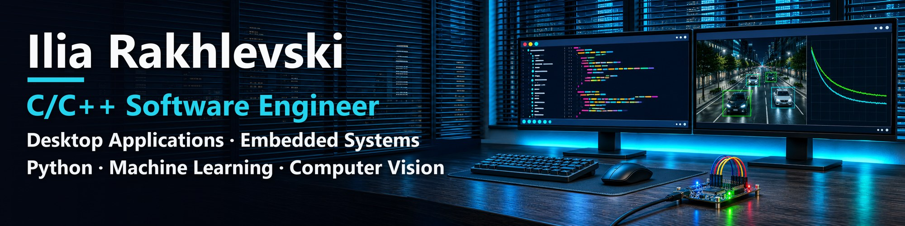

# Hi, I'm Ilia 👋

C/C++ Software Engineer with a strong track record in large-scale production desktop applications. Experienced in complex data processing, performance optimization, and debugging in long-lived codebases. Complemented by a multidisciplinary hardware/software background in embedded firmware for security and industrial systems. Featured below: recent projects in modern C++ (C++17), Linux systems programming and STM32/FreeRTOS firmware, along with machine learning projects in Python (signal processing and computer vision).

## Projects by Area

⭐ — [featured below with details](#user-content-featured-projects).

**C/C++ Software Design**
- [Sea Battle](https://github.com/IliaRakhlevski/Sea-Battle) ⭐ — **C++17** · game-rules library, Strategy and Observer design patterns, targeting strategies compared over 20,000 simulated games
- [Vending Machine](https://github.com/IliaRakhlevski/Vending-Machine) — **C++17** · coffee vending machine as a finite-state machine (State design pattern), every state transition covered by tests
- [Math Expression Evaluator](https://github.com/IliaRakhlevski/Math-Expression-Evaluator) — **C++17** · arithmetic expressions: conversion to Reverse Polish Notation (Shunting Yard), evaluation on a stack, an error code for every failure
- [Custom Memory Manager in C](https://github.com/IliaRakhlevski/Custom-Memory-Manager-in-C) — **C11** · fixed-pool allocator without malloc, detects double free, invalid pointers and corrupted block headers

**Embedded, Real-Time & Linux**
- [STM32 Road Impact Detector](https://github.com/IliaRakhlevski/STM32-Road-Impact-Detector) ⭐ — **C** · FreeRTOS on STM32, IMU + GNSS: road impacts with coordinates and GNSS time (PPS pulse sync)
- [STM32 Peripheral Tester](https://github.com/IliaRakhlevski/STM32-Peripheral-Tester) ⭐ — **C** · FreeRTOS firmware testing UART, SPI, I²C, timer and ADC (via DAC loopback) with a Linux UDP host
- [Step and Servo Motors Control](https://github.com/IliaRakhlevski/Step-Servo-Motors-Control) — **C** · bare-metal ARM9, register-level PWM, GPIO, interrupts, ADC; no HAL
- [Parking System](https://github.com/IliaRakhlevski/Parking-System) ⭐ — **C, C++11** · distributed system: STM32, BeagleBone (Embedded Linux) and a multi-process Linux server, linked by I²C and TCP
- [City Emergency Dispatch](https://github.com/IliaRakhlevski/City-Emergency-Dispatch) ⭐ — **C** · FreeRTOS multitasking on Linux, UDP, priority queues

**Computer Vision & Deep Learning**
- [Detection of Violence Against Children in Videos](https://github.com/IliaRakhlevski/Detection-of-violence-against-children-in-videos) ⭐ — **Python** · M.Sc. final project, CNN + LSTM, staged dataset recorded with dolls
- [License Plates Recognition](https://github.com/IliaRakhlevski/License-Plates-Recognition) — **Python** · Faster R-CNN in PyTorch, self-annotated dataset
- [Traffic Signs Detection](https://github.com/IliaRakhlevski/Traffic-Signs-Detection) — **Python** · Mask R-CNN in Keras/TensorFlow, self-annotated polygon masks
- [One Piece Characters Classification](https://github.com/IliaRakhlevski/Classification-of-One-Piece-characters-using-ResNet18) — **Python** · fine-tuned ResNet18 in PyTorch, 18 classes, no data leakage between train and test, results confirmed with three random seeds
- [Digits Recognition](https://github.com/IliaRakhlevski/Digits-Recognition) — **C++** · HOG features and a fully connected neural network (288 → 288 → 10, backpropagation), both written from scratch

**Machine Learning, Audio & Simulation**
- [Tool Sound Classification](https://github.com/IliaRakhlevski/Classification-of-tools-sounds-using-machine-learning-methods) ⭐ — **Python** · audio signal processing (resampling, normalization, peak envelopes) and a 2D CNN that classifies hammer, jackhammer and drill sounds
- [Speed Dating Experiment](https://github.com/IliaRakhlevski/Speed-Dating-Experiment) — **Python** · exploratory data analysis (EDA), five scikit-learn classifiers, leave-one-wave-out cross-validation
- [Autonomous Road Merging Simulation](https://github.com/IliaRakhlevski/Simulation-of-Autonomous-Road-Merging) — **Python** · Pygame, FSM vehicle control, crashes cut from 45% to 6%

## Technical Focus

| Area | Technologies |
|---|---|
| **Languages** | Modern C++ (C++17), C, Python |
| **Software&nbsp;Design** | OOD; design patterns: State, Strategy, Observer, Composite, Factory Method, Command; dependency injection |
| **Concurrency&nbsp;&amp;&nbsp;IPC** | POSIX threads, processes, mutexes, semaphores, condition variables, shared memory, pipes, signals |
| **Linux&nbsp;Systems** | POSIX APIs, multi-process applications, systemd |
| **Networking&nbsp;&amp;&nbsp;Storage** | TCP/IP, UDP, BSD sockets, SQLite |
| **Embedded&nbsp;&amp;&nbsp;Real‑Time** | ARM Cortex-M (STM32), FreeRTOS, Embedded Linux, bare-metal, HAL/CMSIS, LwIP; interrupts and DMA; UART, SPI, I²C, ADC, DAC, GPIO, PWM |
| **Testing&nbsp;&amp;&nbsp;CI** | Unit tests, reference-implementation checks, end-to-end smoke tests; GitHub Actions on GCC/Clang/MSVC, sanitizers, warnings as errors; cross-compilation for ARM |
| **Machine&nbsp;Learning** | CNNs, transfer learning (ResNet), object detection (Faster R-CNN), video classification (CNN + LSTM); dataset creation and annotation, augmentation, leakage-aware splits, error analysis |
| **Signal&nbsp;&amp;&nbsp;Image&nbsp;Processing** | Audio: resampling, normalization, peak envelopes, sliding windows; images and video: OpenCV preprocessing, frame extraction, sliding-window analysis |
| **Python&nbsp;Libraries** | NumPy, SciPy, Pandas, scikit-learn, PyTorch, TensorFlow/Keras, OpenCV, Pygame |
| **Tools** | Git, SVN, CMake, GNU Make, Visual Studio, VS Code |
| **AI‑Assisted&nbsp;Development** | AI coding tools for implementation, design exploration, debugging and code review, with engineering validation of the results |

## Featured Projects

### Modern C++

#### 🚢 [Sea Battle](https://github.com/IliaRakhlevski/Sea-Battle)

Battleship in C++17 with the classic 10-ship rules (ships may not touch, a hit earns another shot), designed as a reusable game-rules library with a separate console front end.

Key features:

- Rules library with no I/O: board, fleet placement, shooting and game session are independent of the UI
- Pluggable placement and targeting strategies (Strategy), game events for any front end (Observer), dependency injection via `std::unique_ptr`
- Modern C++17: `std::optional`, `std::variant`, RAII, value types, `[[nodiscard]]`
- Computer strategies compared by measurement on simulated games
- Six test programs; CI on GCC, Clang, GCC with sanitizers and MSVC, warnings as errors

### Linux Systems & Concurrency

#### 🚗 [Parking System](https://github.com/IliaRakhlevski/Parking-System)

Distributed parking management system in C and C++11 integrating STM32 firmware, a BeagleBone Green client on Embedded Linux, and multi-process server applications on Linux.

Key features:

- Multi-process Linux architecture with POSIX threads and synchronization
- TCP/IP communication between embedded clients and an event-driven server
- System V shared memory, shared queues, unnamed pipes, and POSIX signals
- SQLite-based parking-session and tariff management
- STM32-to-BeagleBone integration over I²C, with the client started automatically by systemd
- CI for all three platforms: Linux build and library smoke tests (also under ASan and UBSan), BeagleBone ARM cross-build, STM32 firmware build

#### 🚨 [City Emergency Dispatch](https://github.com/IliaRakhlevski/City-Emergency-Dispatch)

Emergency dispatch simulation in C on FreeRTOS (POSIX port on Linux): a server generates city events and a client dispatches them through priority-based event queues to vehicle tasks.

Key features:

- Independent FreeRTOS tasks per vehicle, with department-specific priority queues
- Synchronization with queues, mutexes and event groups
- Fault Manager with automatic retry of interrupted events, and Shift Manager for dynamic vehicle availability
- UDP client-server communication with acknowledgements and completion reports
- SQLite event persistence and runtime statistics under stress testing
- CI: build and an end-to-end smoke test that runs the client and the server together over UDP and checks the event statistics

### Embedded Real-Time Firmware (STM32 + FreeRTOS)

#### 🔧 [STM32 Peripheral Tester](https://github.com/IliaRakhlevski/STM32-Peripheral-Tester)

Automated hardware validation system written in C for STM32F756ZG peripherals, using FreeRTOS and a Linux UDP test host.

Key features:

- Concurrent validation of UART, SPI, I²C, ADC (via DAC loopback), and timer peripherals
- Interrupt- and DMA-based test modes
- Automated PASS/FAIL evaluation with random payload generation and CRC verification
- UDP communication between the STM32 firmware and Linux server
- Runtime statistics and persistent test results stored in SQLite
- CI: firmware build (FreeRTOS + LwIP) with arm-none-eabi-gcc and Linux server build

#### 🛣️ [STM32 Road Impact Detector](https://github.com/IliaRakhlevski/STM32-Road-Impact-Detector)

Real-time road impact candidate detection and GNSS localization system written in C, built on STM32F756ZG and FreeRTOS.

Key features:

- Interrupt-driven ICM-20948 IMU acquisition at approximately 102 samples per second
- Quectel LC86G-LA GNSS positioning with PPS-based hardware timestamp capture
- Common TIM2 timebase for synchronizing IMU measurements with GNSS time
- Acceleration-baseline algorithm associating impact candidates with UTC timestamps and coordinates
- Real-hardware validation with documented field-test output, photographs, and video
- CI: firmware build with arm-none-eabi-gcc

### Machine Learning & Computer Vision

#### 🔊 [Tool Sound Classification](https://github.com/IliaRakhlevski/Classification-of-tools-sounds-using-machine-learning-methods)

Classification of tool sounds (hammer, jackhammer, drill) in Python, designed for real-time classification on a standard PC (CPU only): time-domain signal processing with a 2D CNN in Keras/TensorFlow.

Key features:

- Signal preprocessing with NumPy/SciPy: resampling to 8 kHz, normalization to [-1, 1], fixed 4000-sample frames with zero padding
- Two-level peak envelope extraction in the time domain as a simple, interpretable signal representation
- Sliding-window classification with 50% overlap, a weak-signal threshold and per-file majority voting
- Drill and jackhammer recognized reliably; error analysis of hammer/jackhammer confusion and dataset limitations documented in the README

#### 📹 [Detection of Violence Against Children in Videos](https://github.com/IliaRakhlevski/Detection-of-violence-against-children-in-videos)

M.Sc. final project: detection of physical violence of adults against children in surveillance videos with a CNN + LSTM model in Python and Keras/TensorFlow, trained on a self-recorded staged dataset.

Key features:

- Self-recorded dataset of about 8,000 20-frame clips recorded with reborn dolls instead of children; both classes are recorded in the same scene, so the model learns from the movement only
- ResNet152V2 (ImageNet-pretrained, frozen) extracts the features of each frame; a bidirectional LSTM classifies the movement over 20 frames
- Sliding-window processing of long surveillance videos, with merging of the detected violent fragments
- Tested on 120 videos (45,850 frames) of four types: staged, real with violence, real without violence, empty rooms
- 86% of violent frames detected and 91% of non-violent frames classified correctly; real test videos are kept out of the repository for privacy

## Contact

- Email: [rakhlevski@gmail.com](mailto:rakhlevski@gmail.com)
- LinkedIn: [linkedin.com/in/ilia-rakhlevski](https://www.linkedin.com/in/ilia-rakhlevski/)

